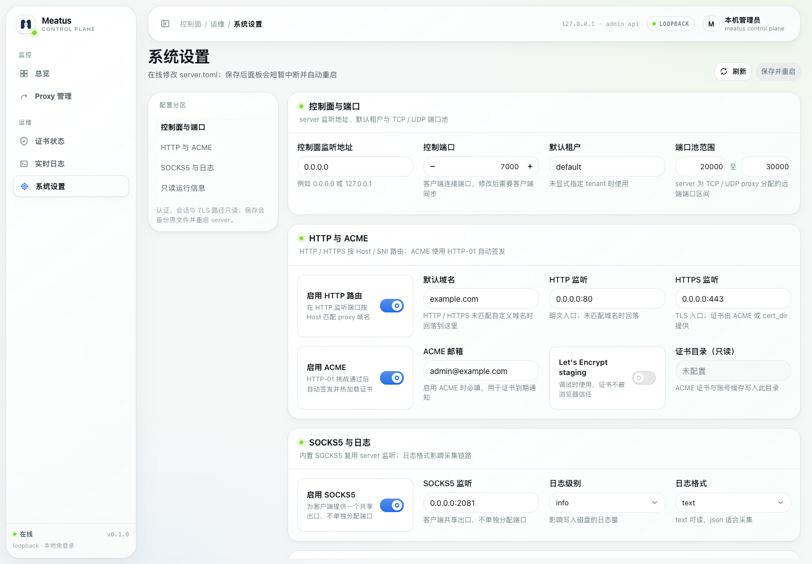
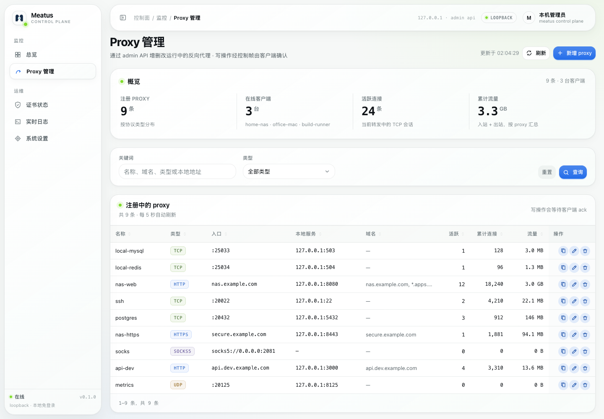
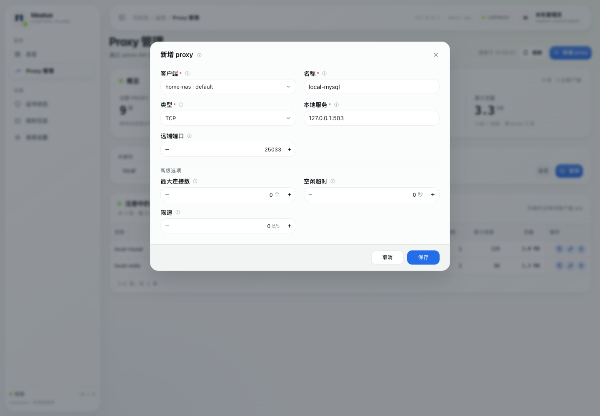
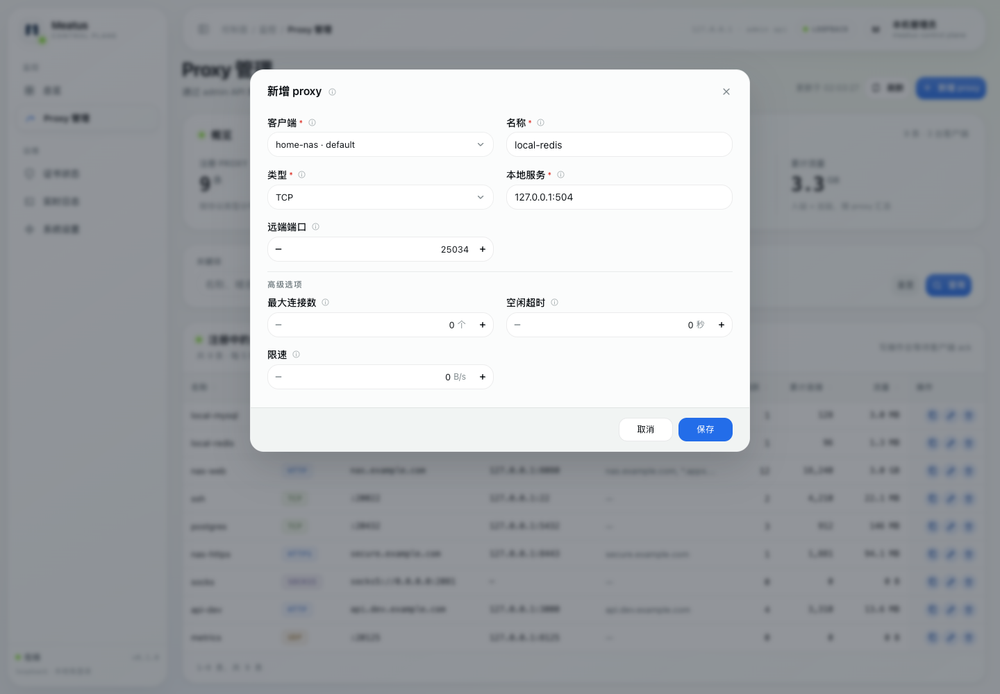
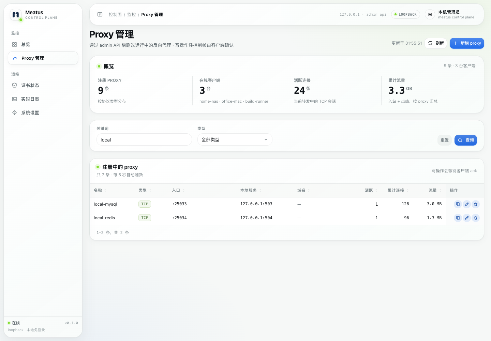

# Meatus 完整使用教程（V1.2）

> 适用版本：Meatus `1.2.1`（包含 `1.1.1` 的 YAML 写回补丁；完全开源、Apache-2.0、自托管）
> 发布状态：当前版本 `1.2.1`；四个平台安装包与 ACR 多架构镜像已发布，Gitee Release：<https://gitee.com/binsail/meatus/releases/tag/v1.2.1>。Windows 暂不提供；GHCR / GitHub Release 暂缓。
> 运行形态：一台公网 **server** + 一台或多台内网 **client**
> 依赖：单二进制 + TOML（默认）/ YAML（管理面可写，规范化重写）；**零 PostgreSQL、零 Redis、零 Node 运行时**
> 配套 AI 教程 Skill：`docs/skill/meatus-tutorial/`（复制到 Agent 的 `.user_skills/` 后可按步骤教学）

本教程覆盖：本机跑通、公网部署、systemd、Docker Compose、纯 `docker run`、配置项、YAML、管理面 TLS、TCP / UDP / HTTP / HTTPS / ACME / SOCKS5、管理面板、指标与日志、热重载、升级备份、故障排查和安全基线。

## V1.2 更新与升级

### V1.2.1 补丁

| 能力 | 说明 |
| --- | --- |
| 代理连通性诊断 | 面板 Proxy 行可“测试本地服务”，覆盖 TCP / HTTP / HTTPS / UDP；结果含可达性、延迟与错误码，单 proxy 限速 1 次 / 秒 |
| DNS-01 泛域名 | 支持 Cloudflare 与腾讯云 DNSPod，可签发 `*.example.com`；到期前 30 天自动续期，失败保留旧证书 |
| 镜像健康检查 | Docker 镜像内置 `HEALTHCHECK`，默认探测 `http://127.0.0.1:7400/healthz`；改过管理面端口时用 `MEATUS_HEALTH_URL` 覆盖 |

### V1.3 带来的变化

| 能力 | 说明 |
| --- | --- |
| 配置热加载 | server 接收 `SIGHUP` 或管理面板保存后重建鉴权/端口策略，已建立连接不受影响 |
| 多客户端调度 | 同一 tenant 下按 client 隔离 proxy 名称与 owner；离线域名 `503`，端口按 `release_policy` 回收/保留 |
| 客户端级授权 | `auth.clients[]` 支持 `allow_types`、`allow_domains`、`max_proxies`，在 proxy 创建时校验，越权返回 `PolicyDenied` |
| 客户端级配额 | 支持 `rate_limit_bps`、`monthly_bytes`、`max_conns`、`conn_rate_per_s`、`quota_action`；按 UTC 自然月累计 |
| 可观测性 | 客户端页展示授权摘要与配额；`/metrics` 增加 `meatus_quota_denied_total`、`meatus_quota_throttled_total` |
| 审计日志 | 登录、配置 / 客户端 / proxy 变更、客户端上下线写入 JSONL；面板“审计日志”可按时间、操作者、client、动作、结果查询最近 90 天 |

### V1.2 带来的变化

| 能力 | 说明 |
| --- | --- |
| 客户端与令牌管理 | 面板「客户端」页可创建、轮换、删除 `auth.clients` token；明文 token 只在响应中出现一次 |
| 新客户端接入引导 | 创建后直接给出 TOML / YAML 客户端配置片段；首次创建自动迁移 `auth.token_sha256` 简写 |
| SOCKS5 域名目标 | `ATYP=3` 支持域名；`options.allow_domains` 精确 / `*.suffix` 白名单，client 单次解析 + CIDR 过滤 |
| 配置写回 | TOML 内联 `clients = [{...}]` 规范化为 `[[auth.clients]]`；写回前备份、原子替换、约 1 秒后重启 |
| 可观测性 | 客户端页显示在线状态、proxy 数量、token 指纹、端口范围；SOCKS5 状态回显 `allow_domains` |

### V1.1 带来的变化


| 能力        | 说明                                                                                               |
| --------- | ------------------------------------------------------------------------------------------------ |
| 管理面独立 TLS | `[admin.tls]` 使用独立证书 / 私钥，不复用隧道 `[server] tls_cert` / `tls_key`；开启后 Cookie 自动带 `Secure`，可发送 HSTS |
| YAML 配置 | 支持 `.yaml` / `.yml`；适合 Git 管理、声明式部署；面板可写回，但会规范化重写 |
| 代理头信任收敛   | `admin.trust_forwarded_proto` 默认 `false`，只在可信反向代理后显式开启                                           |
| 严格 CSP    | 管理面 `style-src 'self'`，不含 `unsafe-inline`；面板不在运行时注入内联样式                                          |
| 发布物料      | 发布包内置 `SBOM.spdx.json`、第三方许可证声明与原文；安装到 `/usr/share/doc/meatus`                                   |
| 多架构镜像     | ACR 提供 linux/amd64、linux/arm64；标签 `1.2.1` / `1.2` / `latest`                                     |

### V1.1.1 补丁（并入 1.2.0）

- YAML 配置从只读改为管理面可写：`server.yaml` 系统设置、`client.yaml` proxy 增删都会持久化；写回采用规范化重写，注释和键顺序不保证保留。
- 管理设置响应新增 `config_format`，设置页底部显示当前配置格式；server YAML 写回前生成 `.bak` 备份。
- 管理面板补充搜索栏操作按钮、日志页桌面端滚动、操作列与表单栅格细节修正。
- `1.1.1` 不单独发布；相关修复已随 `1.2.0` 一起发布。

### 兼容性


* **现有 TOML 配置继续可用**，不需要迁移数据库或改 token；V1.0 的 `server.toml` / `client.toml` 可直接被 `1.2.1` 读取。

* `[admin.tls]` 是可选能力；不开启时行为与 V1.0 一致，但非 loopback 仍必须配置 `admin_token`。

* YAML 是可选格式，**管理面可写**；面板保存会写回 YAML，但会规范化重写，注释和键顺序不保证保留。

* 当前发布仓库是 **阿里云 ACR**；GHCR 与 GitHub Release 暂缓，不要把 `ghcr.io` 当作可用地址。

* 管理面 CSP 收紧后，旧的自定义内联样式注入方式不再生效；面板本身已全部改为外部样式表。

### 从 1.0.0 升级


```
# 1. 备份配置、证书与 token
sudo tar czf meatus-backup-$(date +%F).tgz \
  -C / var/lib/meatus etc/meatus

# 2. 下载并校验 1.2.1 发布包
VERSION=1.2.1
TARGET=x86_64-unknown-linux-musl
curl -LO "https://gitee.com/binsail/meatus/releases/download/v${VERSION}/meatus-${VERSION}-${TARGET}.tar.gz"
sha256sum -c "meatus-${VERSION}-${TARGET}.tar.gz.sha256"
tar xzf "meatus-${VERSION}-${TARGET}.tar.gz"

# 3. 替换二进制，保留原配置
sudo systemctl stop meatus-server meatus-client
sudo install -m 0755 "meatus-${VERSION}-${TARGET}/meatus" /usr/local/bin/meatus

# 4. 校验并启动
sudo meatus check -c /etc/meatus/server.toml
sudo meatus check -c /etc/meatus/client.toml
sudo systemctl start meatus-server meatus-client

# 5. 确认版本、健康检查与隧道
meatus --version
curl -fsS http://127.0.0.1:7400/healthz
nc -vz <server> 20022
```

升级后如需管理面 HTTPS 或 YAML 配置，按第 6.1 节、第 3.1.1 节启用；两项都不是升级的强制项。回滚时恢复旧二进制与备份配置即可，V1.1 不修改 V1.0 配置结构。


***

## 0. 先理解 Meatus 的工作方式


```
公网用户
   │  访问 remote_port 或域名
   ▼
┌────────────────────────────┐
│ Meatus server（公网）       │
│ 7000/tcp  控制面 TLS+yamux  │
│ 80/443    HTTP/HTTPS 入口   │
│ 20000+    TCP/UDP 端口池    │
│ 7400      面板 / metrics    │
└─────────────┬──────────────┘
              │ client 主动外拨，TLS 1.3
              ▼
┌────────────────────────────┐
│ Meatus client（内网）       │
│ 把流量转发到本机 / 内网服务  │
└─────────────┬──────────────┘
              ▼
       内网服务：SSH、Web、DNS、数据库等
```

关键点：


* **client 主动连 server**，内网不需要公网 IP，也不需要端口映射。

* server 与 client 是**同一个二进制**，只用子命令区分：`meatus server` / `meatus client`。

* server 只保存客户端 token 的 **SHA-256**；明文 token 只交给 client。

* 管理面板默认只绑 `127.0.0.1:7400`，公网服务器请通过 SSH 隧道访问，不要直接暴露。

* V1 不依赖数据库；配置、token、证书都是本地文件。


***

## 1. 10 分钟本机跑通（最小可用）

这一节在一台机器上同时启动 server 和 client，用 `127.0.0.1` 验证 TCP 隧道。适合第一次接触或本地开发。

### 1.1 构建

需要 Rust `1.96.0`；如果要自己构建管理面板，还需要 Node ≥ 20.19 /npm ≥ 10。


```
git clone https://gitee.com/binsail/meatus.git meatus
cd meatus
cargo build --release

# 如果 web/dist 不存在，先构建面板
cd web && npm ci && npm run build && cd ..
cargo build --release
```

产物：`target/release/meatus`。

> 运行 `meatus server` 不需要 Node，面板静态资源已经编进二进制。

### 1.2 生成证书和 token


```
mkdir -p certs

# 自签证书；SAN 同时写域名和 127.0.0.1，方便本机测试
./target/release/meatus gen-cert \
  --domain localhost \
  --domain 127.0.0.1 \
  --out certs

# 生成客户端 token；输出 token 与 sha256
./target/release/meatus gen-token
```

`gen-token` 会输出类似：


```
token   X-soKlfDMY1UswzI9JaKKQH9Fa4KWcvB9E5LRdCrP18
sha256  ed35c7e7bfefdcaade04956001ac051f4509b6b74cd2cfb03f3008b00d900eff
```


* 明文 `token`：填到 client 的 `client.token`。

* `sha256`：填到 server 的 `auth.clients[].token_sha256`。

* 明文 token 不要写进仓库、日志或聊天记录。

* 需要管理面 HTTPS 时，另建 `certs/admin` 再生成一张独立证书：`meatus gen-cert --domain admin.example.com --out certs/admin`，详见第 6.1 节。

### 1.3 写 server.toml


```
[server]
bind_addr = "127.0.0.1"
control_port = 7000
tls_cert = "certs/server.crt"
tls_key = "certs/server.key"

[tenant]
default = "default"

[auth]
mode = "hmac"
provider = "local"
clients = [
  { id = "home-nas", tenant = "default", token_sha256 = "<把 gen-token 的 sha256 填这里>" },
]

[ports]
range = [20000, 20999]

[http]
enabled = false

[acme]
enabled = false

[socks5]
enabled = false

[admin]
bind = "127.0.0.1:7400"
panel = true

[log]
level = "info"
format = "text"
```

说明：


* `bind_addr = "127.0.0.1"` 只用于本机测试；公网 server 改成 `0.0.0.0`。

* 配置路径按**进程当前目录**解析；不确定时写绝对路径。

* 本机 loopback 且不配 `admin_token` 时，面板会自动进入，不要求登录。

* 公网或非 loopback 必须配置 `admin_token`，否则配置校验直接拒绝启动。

### 1.4 写 client.toml


```
[client]
server_addr = "127.0.0.1:7000"
server_name = "localhost"
client_id = "home-nas"
tenant = "default"
token = "<把 gen-token 输出的 token 填这里>"
server_ca_cert = "certs/server.crt"

[[proxy]]
name = "ssh"
type = "tcp"
local_addr = "127.0.0.1:22"
remote_port = 20022

[log]
level = "info"
format = "text"
```

说明：


* `client_id` 必须和 server 的 `auth.clients[].id` 完全一致。

* `server_name` 必须和 server 证书 SAN 一致；本机用 `localhost`。

* 自签证书场景，`server_ca_cert` 指向 server 的 `server.crt`。

* `local_addr` 是 client 所在机器能访问到的内网服务；本机示例是 SSH 的 `22`。

### 1.5 校验并启动


```
./target/release/meatus check -c server.toml
./target/release/meatus check -c client.toml

# 终端 1
./target/release/meatus server -c server.toml

# 终端 2
./target/release/meatus client -c client.toml
```

看到 client 日志出现 `tunnel established`、`proxy registered` 即接入成功。

### 1.6 验证


```
# 面板健康检查（公开，不需要 token）
curl -fsS http://127.0.0.1:7400/healthz

# 通过 server 的 20022 访问内网 SSH
nc -vz 127.0.0.1 20022
ssh -p 20022 <user>@127.0.0.1
```

浏览器打开 `http://127.0.0.1:7400/` 即可看到管理面板。


***

## 2. 公网 server 部署

### 2.1 方式 A：release 包 + systemd（推荐 Linux）


```
VERSION=1.2.1
TARGET=x86_64-unknown-linux-musl
curl -LO "https://gitee.com/binsail/meatus/releases/download/v${VERSION}/meatus-${VERSION}-${TARGET}.tar.gz"
sha256sum -c "meatus-${VERSION}-${TARGET}.tar.gz.sha256"
tar xzf "meatus-${VERSION}-${TARGET}.tar.gz"
cd "meatus-${VERSION}-${TARGET}"

sudo ./scripts/install.sh \
  --binary ./meatus \
  --domain tunnel.example.com \
  --server-addr tunnel.example.com:7000
```

`install.sh` 会创建：


| 路径                         | 内容                                        |
| -------------------------- | ----------------------------------------- |
| `/usr/local/bin/meatus`    | 二进制                                       |
| `/etc/meatus/server.toml`  | server 配置                                 |
| `/etc/meatus/client.toml`  | client 模板                                 |
| `/var/lib/meatus/certs/`   | 自签证书                                      |
| `/var/lib/meatus/acme/`    | ACME 证书缓存                                 |
| `/etc/meatus/client.token` | 客户端明文 token                               |
| `/etc/meatus/admin.token`  | 面板 token                                  |
| `/usr/share/doc/meatus`    | LICENSE、第三方许可证声明与原文、`SBOM.spdx.json`、示例配置 |

发布包完整性检查：


```
# 主包必须带 SBOM、许可证物料和安装脚本
tar tzf "meatus-${VERSION}-${TARGET}.tar.gz" | \
  grep -E 'SBOM.spdx.json|THIRD_PARTY|LICENSE|scripts/install.sh'

# 安装后确认许可证与 SBOM 已落盘
ls -l /usr/share/doc/meatus
```

启动与查看：


```
systemctl status meatus-server
journalctl -u meatus-server -f
cat /etc/meatus/client.token
cat /etc/meatus/admin.token
```

### 2.2 方式 B：Docker Compose


```
cd deploy/docker
MEATUS_DOMAIN=tunnel.example.com docker compose up -d --build
docker compose ps
docker compose logs -f meatus
```

首次启动会自动在命名卷 `meatus-data`（容器内 `/data`）生成：


* `/data/server.toml`

* `/data/certs/server.crt` / `server.key`

* `/data/admin.token`

* `/data/client.token`

取文件：


```
docker compose exec meatus cat /data/admin.token
docker compose exec meatus cat /data/client.token
docker compose cp meatus:/data/certs/server.crt ./server.crt
```

面板：


```
# 服务器上开隧道
ssh -L 7400:127.0.0.1:7400 <user>@<server>
# 本机浏览器打开 http://127.0.0.1:7400
```

### 2.3 方式 C：纯 `docker run`（不装 Compose）

以下 Docker 示例使用阿里云 ACR（当前发布仓库）。ACR 仓库目前为私有，拉取前先执行 `docker login registry.cn-hangzhou.aliyuncs.com`。GHCR 镜像尚未推送，不要使用 `ghcr.io` 地址。

#### server


```
# ACR 当前为私有仓库，先登录
docker login registry.cn-hangzhou.aliyuncs.com

docker volume create meatus-data

docker run -d --name meatus-server \
  --restart unless-stopped \
  --stop-timeout 20 \
  -p 7000:7000 \
  -p 127.0.0.1:7400:7400 \
  -v meatus-data:/data \
  -e MEATUS_DOMAIN=tunnel.example.com \
  --health-cmd "wget -qO- http://127.0.0.1:7400/healthz >/dev/null || exit 1" \
  --health-interval 30s \
  --health-timeout 5s \
  --health-start-period 10s \
  --health-retries 3 \
  registry.cn-hangzhou.aliyuncs.com/mist/meatus:1.2.1 \
  server --config /data/server.toml
```

查看：


```
docker ps --filter name=meatus-server
docker inspect -f '{{.State.Health.Status}}' meatus-server
docker logs -f meatus-server
docker exec meatus-server cat /data/admin.token
docker cp meatus-server:/data/client.token ./client.token
docker cp meatus-server:/data/certs/server.crt ./server.crt
```

按需增加业务端口：


```
-p 20022:20022        # TCP proxy
-p 20053:20053/udp    # UDP proxy
-p 80:80              # 开启 [http]
-p 443:443            # 开启 [http] / ACME 终止
```

> 容器**不会自动映射** client 申请的 `remote_port`，每个要公网访问的端口都要显式 `-p`。

停止 / 删除：


```
docker stop meatus-server
docker rm meatus-server
# 不要加 -v；否则会删除配置、证书和 token
```

#### client


```
cp deploy/docker/client.example.toml ./client.toml
# 修改 server_addr / server_name / client_id / token / local_addr

docker run -d --name meatus-client \
  --restart unless-stopped \
  -v "$PWD/client.toml:/data/client.toml" \
  -v "$PWD/server.crt:/data/server.crt:ro" \
  --add-host host.docker.internal:host-gateway \
  registry.cn-hangzhou.aliyuncs.com/mist/meatus:1.2.1 \
  client --config /data/client.toml

docker logs -f meatus-client
```


* client 容器不需要发布端口，端口由 server 监听。

* Docker Desktop / OrbStack 用 `host.docker.internal` 访问宿主机；Linux 用 `--add-host host.docker.internal:host-gateway`。

* 目标服务就在宿主机时，`local_addr` 写 `host.docker.internal:8080`；Linux 也可 `--network host` 后写 `127.0.0.1:8080`。

### 2.4 预构建镜像


```
# 当前 1.2.1 只发布到阿里云 ACR；先登录私有仓库
docker login registry.cn-hangzhou.aliyuncs.com

# 固定版本 / 次版本 / 最新
docker pull registry.cn-hangzhou.aliyuncs.com/mist/meatus:1.2.1
docker pull registry.cn-hangzhou.aliyuncs.com/mist/meatus:1.2
docker pull registry.cn-hangzhou.aliyuncs.com/mist/meatus:latest
```

server /client 使用同一镜像，启动参数同上，只替换镜像名。多架构 manifest 同时覆盖 `linux/amd64` 与 `linux/arm64`。


* `1.2.1` 多架构 index digest：`sha256:bc1f9ae5e496bc83bb02bf50170ffbb4ffca4ade1e2ccea6d4b3d27bf2f7881e`

* ACR 仓库当前为私有：匿名拉取返回 401；使用方必须先 `docker login`，或由仓库管理员在 ACR 控制台改为公开。

* GHCR / GitHub Release 暂缓；当前不要使用 `ghcr.io/binsail/meatus`。

### 2.5 防火墙 / 安全组


| 端口            | 用途                  | 建议                             |
| ------------- | ------------------- | ------------------------------ |
| `7000/tcp`    | 控制面 TLS             | 对公网开放，只允许 client 网段更佳          |
| `80/443/tcp`  | HTTP / HTTPS / ACME | 开启 `[http]` 时开放                |
| `20000–30000` | TCP / UDP 端口池       | 按实际 proxy 的 `remote_port` 逐个开放 |
| `7400/tcp`    | 面板 /metrics         | **只绑 127.0.0.1，不开放公网**         |
| `2080/tcp`    | SOCKS5              | 默认关闭；开启时再按需开放                  |

云服务器安全组与系统防火墙（`ufw` / `firewalld`）两层都要放行。

### 2.6 完整案例：公网 IP + 本机客户端（YAML）

场景：服务端在公网 `203.0.113.10`，客户端在本地电脑，把本机 SSH `127.0.0.1:22` 映射到服务端 `20022`。`203.0.113.10` 是 RFC 5737 文档示例地址，不可用于真实连接；请替换成自己的公网地址。

#### 服务端：`/etc/meatus/server.yaml`

```yaml
server:
  bind_addr: "0.0.0.0"
  control_port: 7000
  tls_cert: "/etc/meatus/certs/server.crt"
  tls_key: "/etc/meatus/certs/server.key"

auth:
  mode: "hmac"
  provider: "local"
  clients:
    - id: "home-nas"
      tenant: "default"
      token_sha256: "<gen-token 输出的 sha256>"

ports:
  range: [20000, 30000]

admin:
  bind: "127.0.0.1:7400"
  panel: true
  tls:
    enabled: false

log:
  level: "info"
  format: "text"
```

服务端配置里**没有 `server_addr`**。它监听的是 `bind_addr` + `control_port`：

```bash
sudo meatus check -c /etc/meatus/server.yaml
sudo systemctl restart meatus-server
```

token 用 `meatus gen-token` 生成：输出的明文 `token` 填到客户端，`sha256` 填到服务端的 `token_sha256`。

证书签给公网 IP 时可以直接生成：

```bash
sudo mkdir -p /etc/meatus/certs
sudo meatus gen-cert --domain 203.0.113.10 --out /etc/meatus/certs
```

该命令会生成带 `IP Address:203.0.113.10` SAN 的证书。目录里已有证书时 `gen-cert` 会拒绝覆盖；确需重建，先备份再显式加 `--force`。

如果证书是签给域名的，跳过这一步，改用现有域名证书；下面客户端的 `server_name` 必须改成该域名。

#### 客户端：本机 `client.yaml`

先把服务端证书复制到本机，作为 `server_ca_cert`：

```bash
mkdir -p certs
scp root@203.0.113.10:/etc/meatus/certs/server.crt certs/server.crt
```

```yaml
client:
  server_addr: "203.0.113.10:7000"
  server_name: "203.0.113.10"
  client_id: "home-nas"
  tenant: "default"
  token: "<gen-token 输出的明文 token>"
  server_ca_cert: "certs/server.crt"

proxy:
  - name: "ssh"
    type: "tcp"
    local_addr: "127.0.0.1:22"
    remote_port: 20022

log:
  level: "info"
  format: "text"
```

要点：

- `server_addr` 只写在**客户端**，格式为 `公网IP:控制端口`，不能带 `http://`。
- `server_name` 必须与服务端证书的域名 / IP SAN 一致。证书签给域名时写域名，不能写 IP。
- `server_ca_cert` 是服务端证书副本；使用公网 CA 证书时这一行可以删除。
- `local_addr` 是客户端本机被暴露的服务地址，不是公网地址。
- `remote_port` 必须在服务端的 `ports.range` 内，并在安全组放行。

启动并验证：

```bash
# 本机
meatus check -c client.yaml
meatus client --config client.yaml

# 另开终端
ssh -p 20022 <用户>@203.0.113.10
```

安全组至少放行：

- `7000/tcp`：客户端连接控制面
- `20022/tcp`：SSH 映射端口

`7400/tcp` 是管理面板，保持只绑 `127.0.0.1`，不要对公网开放。

***

## 3. 配置文件详解

### 3.1 server.toml

#### `[server]`


| 字段             | 必填 | 默认        | 说明                             |
| -------------- | -- | --------- | ------------------------------ |
| `bind_addr`    | 否  | `0.0.0.0` | 控制面监听地址                        |
| `control_port` | 否  | `7000`    | 控制面端口，必须 ≥ 1024                |
| `tls_cert`     | 是  | —         | TLS 证书 PEM；缺失会拒绝启动             |
| `tls_key`      | 是  | —         | TLS 私钥 PEM；与 `tls_cert` 必须同时存在 |

#### `[tenant]`


| 字段        | 默认        | 说明                                     |
| --------- | --------- | -------------------------------------- |
| `default` | `default` | V1 固定 `default`；资源键仍带 tenant 前缀，便于后续扩展 |

#### `[auth]`


| 字段             | 默认      | 说明                      |
| -------------- | ------- | ----------------------- |
| `mode`         | `hmac`  | 当前使用 HMAC 挑战应答          |
| `provider`     | `local` | 本地 token 校验             |
| `token_sha256` | —       | 单客户端简写；多客户端请用 `clients` |
| `clients`      | `[]`    | 多客户端列表                  |

`clients[]` 字段：


```
clients = [
  { id = "home-nas", tenant = "default", token_sha256 = "<64 hex>" },
  { id = "office", tenant = "default", token_sha256 = "<64 hex>", allow_ports = [20000, 20100] },
]
```


| 字段             | 说明                                   |
| -------------- | ------------------------------------ |
| `id`           | 客户端 ID，必须唯一；client 的 `client_id` 要一致 |
| `tenant`       | 租户，V1 写 `default`                    |
| `token_sha256` | `gen-token` 输出的 sha256，64 位小写 hex    |
| `allow_ports`  | 可选，限制该 client 可申请的端口范围               |
| `allow_types`  | 可选，允许的 proxy 类型：`tcp/udp/http/https/socks5`；空表示全部 |
| `allow_domains`| 可选，域名白名单，支持 `*.example.com`；空表示不限 |
| `max_proxies`  | 可选，该 client 跨 run 允许存在的 proxy 总数，1–1024 |
| `limits`       | 可选，客户端级配额，见下表 |

`limits` 字段：

| 字段 | 说明 |
| --- | --- |
| `rate_limit_bps` | 带宽上限，bytes/s；空或 0 表示不限 |
| `monthly_bytes` | 月流量上限，bytes；空或 0 表示不限，按 UTC 自然月归零 |
| `max_conns` | 并发连接上限，1–65535 |
| `conn_rate_per_s` | 新建连接速率上限，连接/秒，≤100000 |
| `quota_action` | `reject` 拒绝新连接；`throttle` 降到 64 KiB/s，均不超过原带宽上限 |

proxy 自身的 `options.rate_limit_bps` / `options.max_conns` / `options.monthly_bytes` / `options.conn_rate_per_s` 与 client `limits` 同时存在时取较小值；proxy 设置会覆盖 client 的 `quota_action`。

注意：


* 同一个 tenant 下 `id` 不能重复。

* 每个 client 建议单独 token；一个 token 泄露只影响一个客户端。

* `max_proxies` 统计的是该 tenant + client 当前跨 run 的 proxy 总数；达到上限后新建返回 `PolicyDenied`。

* 月配额按 UTC 自然月累计，跨月首次请求时归零；`throttle` 只作用于新连接，不会提高已有连接速度。

* server 不保存明文 token，无法从 server 反查 token。

#### `[ports]`


```
[ports]
range = [20000, 30000]
release_policy = "immediate"   # immediate | hold
hold_secs = 300                # hold 时保留秒数，1..86400
```


* `start >= 1024`，`start <= end`。

* `release_policy = "immediate"`：客户端断开后立刻释放公网端口。

* `release_policy = "hold"`：端口保留 `hold_secs` 秒，同一 tenant + proxy 名称的客户端重连时优先取回；保留期内对应 HTTP 域名返回 `503 Service Unavailable`。

* 无论端口是否立即释放，对应 HTTP 域名在 `hold_secs` 内都返回 `503`；`hold_secs = 0` 可关闭该离线标记窗口。

* TCP / UDP 的 `remote_port`、端口池分配都受此范围约束。

* Docker 部署还要把实际使用的端口 `-p` 出去。

#### `[http]`


```
[http]
enabled = true
bind = "0.0.0.0:80"
https_bind = "0.0.0.0:443"
domain = "*.tunnel.example.com"
```


| 字段           | 说明                                         |
| ------------ | ------------------------------------------ |
| `enabled`    | 开启 HTTP/HTTPS 入口；不开启时只做 TCP/UDP            |
| `bind`       | HTTP 监听地址，默认 `0.0.0.0:80`                  |
| `https_bind` | HTTPS 监听地址，默认 `0.0.0.0:443`                |
| `domain`     | 配置校验用示例域名；实际路由来自 client 的 `custom_domains` |

#### `[acme]`


```
[acme]
enabled = true
email = "ops@example.com"
challenge = "dns-01"
dns_provider = "cloudflare"
dns_api_token = "${CF_API_TOKEN}"
staging = true
cert_dir = "/var/lib/meatus/acme"
```

DNSPod（腾讯云域名）把 provider 与 token 换成：

```toml
[acme]
challenge = "dns-01"
dns_provider = "dnspod"
dns_api_token = "${DNSPOD_TOKEN}" # 控制台生成的 ID,Token
```

DNSPod 会在账号域名列表里按 `*.tunnel.example.com → tunnel.example.com → example.com` 逐级查找所属根域名；TXT 记录使用 `Record.Create` / `Record.Remove`，TTL 600，线路“默认”。Token 在 DNSPod 控制台「用户中心 → 密钥管理」创建，必须保存为 `ID,Token` 两段；建议只授权该账号下的解析权限。

精确域名优先用 `challenge = "http-01"`；泛域名必须 `dns-01`。若 `dns-01` 下未启用 HTTP，精确域名也会走 DNS-01。DNS-01 支持 Cloudflare 与 DNSPod。`dns_api_token` 支持 `${VAR}` 环境变量展开，token 不会写日志，也不会出现在 `/api/v1/settings` 响应中。

| 字段             | 说明                                                       |
| -------------- | -------------------------------------------------------- |
| `enabled`      | 开启 ACME；`http-01` 需要 `http.enabled = true`，`dns-01` 不依赖 80 端口 |
| `email`        | Let's Encrypt 账户邮箱，必填                                    |
| `challenge`    | `http-01`（精确域名）或 `dns-01`（泛域名）；`tls-alpn-01` 未接入           |
| `dns_provider` | `dns-01` 时必填，支持 `cloudflare` / `dnspod`                           |
| `dns_api_token` | provider 对应的 API Token：Cloudflare 需要 `Zone:Read + Zone.DNS:Edit`；DNSPod 使用 `ID,Token`。建议写成 `${CF_API_TOKEN}` / `${DNSPOD_TOKEN}`，缺失变量启动直接报错   |
| `staging`      | 先用 staging，避免打光生产配额                                       |
| `cert_dir`     | 证书与账户缓存目录，默认 `/etc/meatus/acme`                          |
| `directory`    | ACME directory URL，可指向 Pebble / staging；Pebble 自签 CA 需额外信任配置，当前未内置                 |

面板 **系统设置 → HTTP 与 ACME** 可在线切换 `http-01` / `dns-01`，选择 Cloudflare 或 DNSPod 并填写对应 Token。Token 已配置时输入框留空表示保留原值；面板只显示“已配置”，不会回显 token。保存后面板会重启 server 使新配置生效。

DNS-01 行为：

* 按 `_acme-challenge.<域名>` 创建 TXT 记录，等待约 10 秒传播后通知 ACME 校验，完成或失败都会清理 TXT；
* 泛域名证书按 SNI 通配匹配，`*.example.com` 可终止 `app.example.com`，但不覆盖 `a.b.example.com`（TLS 通配符只匹配一级标签）；
* 到期前 30 天自动续期；续期失败保留旧证书、旧 resolver 与现有连接，失败原因显示在面板证书页；
* Cloudflare / DNSPod token 权限不足、zone 不存在、DNS 超时都会以明确错误写入面板，不会删除旧证书。

#### `[socks5]`


```
[socks5]
enabled = true
bind = "0.0.0.0:2080"
```

默认关闭。开启后只支持 `CONNECT` 与 IP 目标，目标默认限内网 CIDR。

#### `[admin]`


```
[admin]
bind = "127.0.0.1:7400"
panel = true
admin_token = "<64 hex>"
trust_forwarded_proto = false

[admin.tls]
enabled = true
cert = "/data/certs/admin.crt"
key = "/data/certs/admin.key"
hsts = true
```


| 字段                      | 说明                                                   |
| ----------------------- | ---------------------------------------------------- |
| `bind`                  | 面板 /metrics/ API 监听地址                                |
| `panel`                 | 是否提供静态面板；`false` 时静态资源返回 404                         |
| `admin_token`           | 非 loopback 必填；loopback 为空时自动免登录                      |
| `trust_forwarded_proto` | 仅当管理面在可信反向代理之后时开启；默认 `false`，不信任 `X-Forwarded-Proto` |
| `tls.enabled`           | 开启管理面 HTTPS；开启后必须同时提供 `cert` / `key`                 |
| `tls.cert`              | 管理面证书 PEM；与隧道 `[server] tls_cert` 独立                 |
| `tls.key`               | 管理面私钥 PEM；权限建议 0600                                  |
| `tls.hsts`              | HTTPS 响应是否发送 HSTS；默认 `true`                          |

生成 admin token：


```
openssl rand -hex 32
```

管理面 TLS 的边界：


* 不复用隧道 `[server] tls_cert` / `tls_key`，避免业务证书轮换影响面板；

* 非 loopback 仍必须设置 `admin_token`，开启 TLS 不会放宽认证；

* HTTPS 下会话 Cookie 自动带 `Secure`；HTTP 只建议 loopback 或 SSH 隧道；

* 反向代理场景确认代理会覆盖 `X-Forwarded-Proto` 后，才可打开 `trust_forwarded_proto`；

* 证书加载失败会直接拒绝启动，不做 HTTP 降级。

安全建议：


* 公网服务器优先使用 `[admin.tls]` 绑定非 loopback，或保持 `127.0.0.1:7400` 通过 SSH 隧道访问。

* 不要把 7400 直接暴露到公网而不启用 TLS。

* `admin_token` 只放配置文件 / `/data/admin.token`，权限 0600。

#### `[log]`


```
[log]
level = "info"
format = "text"
```


* `level`：`trace` / `debug` / `info` / `warn` / `error`。

* `format`：`text` 或 `json`；接日志系统时用 `json`。

### 3.1.1 YAML 配置（管理面可写）

支持 `.yaml` / `.yml`。管理面板可以写回 YAML：系统设置保存到 `server.yaml`，client proxy 增删保存到 `client.yaml`。写回采用规范化重写，未编辑的字段值会保留，但注释和键顺序不保证保留；需要严格保留注释时继续用 TOML。


```
meatus server --config server.yaml
meatus client --config client.yaml
meatus check --config server.yaml
meatus check --config client.yaml --format yaml
```

完整示例见仓库 `config/server.example.yaml`、`config/client.example.yaml`。TOML 仍是默认格式；扩展名无法识别时按 TOML 解析，可用 `--format auto|toml|yaml` 强制。

最小 `server.yaml`：


```
server:
  bind_addr: "0.0.0.0"
  control_port: 7000
  tls_cert: "/etc/meatus/certs/server.crt"
  tls_key: "/etc/meatus/certs/server.key"

auth:
  mode: "hmac"
  provider: "local"
  clients:
    - id: "home-nas"
      tenant: "default"
      token_sha256: "<gen-token 的 sha256>"

ports:
  range: [20000, 30000]

admin:
  bind: "127.0.0.1:7400"
  panel: true
  trust_forwarded_proto: false
  tls:
    enabled: false

log:
  level: "info"
  format: "text"
```

最小 `client.yaml`：


```
client:
  server_addr: "tunnel.example.com:7000"
  server_name: "tunnel.example.com"
  client_id: "home-nas"
  tenant: "default"
  token: "${MEATUS_CLIENT_TOKEN}"
  server_ca_cert: "/etc/meatus/certs/server.crt"

proxy:
  - name: "ssh"
    type: "tcp"
    local_addr: "127.0.0.1:22"
    remote_port: 20022

log:
  level: "info"
  format: "text"
```

注意：


* 配置值里的 `${ENV_NAME}` 会在启动时展开，变量缺失直接报错；token 建议用环境变量而不是明文写进 YAML。

* 扩展名决定默认格式；文件名不是 `.yaml/.yml` 时必须加 `--format yaml`。

* Docker 挂载 YAML 时，若需要面板写回必须使用可写挂载；`:ro` 只读挂载下面板保存会失败。启动命令用 `--config /data/server.yaml`。

* `meatus check` 会输出实际格式，例如 `OK  server.yaml (server, yaml)`；解析错误会报告 `文件: line N, column M`。

写回行为：


| 操作                       | TOML                | YAML                    |
| ------------------------ | ------------------- | ----------------------- |
| 面板改 server 系统设置          | 写回并重启；保留注释          | 写回并重启；规范化重写，注释不保证保留 |
| 面板增删 client proxy        | 写回 `client.toml`；保留注释 | 写回 `client.yaml`；规范化重写  |
| `SIGHUP` 热重载             | 支持                  | 支持                      |
| 配置互转 / `!include` / 远程引用 | 不提供                 | 不提供                     |

YAML 写回前会先解析并校验；校验失败不会覆盖原文件。成功写回时，服务端会生成 `.bak` 备份并重启，客户端 proxy 写回不生成备份。需要严格保留注释和键顺序时，请继续使用 TOML。

### 3.2 client.toml

#### `[client]`


| 字段                      | 必填 | 说明                                      |
| ----------------------- | -- | --------------------------------------- |
| `server_addr`           | 是  | `host:port`，如 `tunnel.example.com:7000` |
| `server_name`           | 否  | TLS SNI / 证书校验名；自签时写证书 SAN              |
| `client_id`             | 否  | 默认 `default`；必须匹配 server `clients[].id` |
| `tenant`                | 否  | 默认 `default`                            |
| `token`                 | 是  | 明文 token                                |
| `server_ca_cert`        | 否  | 自签 / 私有 CA 的根证书；公网 CA 留空                |
| `server_public_key_pin` | 否  | 可选 SPKI pin，`sha256:<64hex>` 或裸 64 hex  |

#### `[[proxy]]`


```
[[proxy]]
name = "web"
type = "tcp"
local_addr = "127.0.0.1:8080"
remote_port = 20022
```


| 字段                       | 说明                                                                           |
| ------------------------ | ---------------------------------------------------------------------------- |
| `name`                   | proxy 名，不能为空、不能含 `/`；同一 client 内唯一                                           |
| `type`                   | `tcp` / `udp` / `http` / `https` / `socks5`                                  |
| `local_addr`             | client 侧目标地址 `host:port`                                                     |
| `remote_port`            | server 侧端口；HTTP/HTTPS/SOCKS5 写 `0`                                           |
| `custom_domains`         | HTTP/HTTPS 必填；小写、不能有空白、全局唯一                                                  |
| `options.rate_limit_bps` | 可选限速，单位 **B/s（字节 / 秒）**；按 proxy 双向共享令牌桶，默认 `0` 不限                            |
| `options.idle_timeout_s` | **仅 UDP**：会话空闲回收，默认 `60`，范围 `15–3600`；TCP / HTTP / HTTPS / SOCKS5 不使用        |
| `options.max_conns`      | 并发连接 / UDP 会话上限；`0` 使用默认值 `1024`（UDP 为 `2048`），TCP 最大 `4096`，UDP 有效上限 `2048` |
| `options.allow_cidrs`    | SOCKS5 目标白名单；不填用默认内网集合                                                       |

#### 环境变量占位符

配置里可以写 `${VAR}`：


```
[client]
token = "${MEATUS_CLIENT_TOKEN}"
```

启动时展开；变量不存在会直接报错，不会静默变成空串。适合 Docker /systemd 注入密钥：


```
export MEATUS_CLIENT_TOKEN='...'
```

### 3.3 校验配置


```
# 自动识别 server / client 与 TOML / YAML
meatus check -c server.toml
meatus check -c server.yaml
meatus check -c client.toml

# 强制类型与格式
meatus check -c server.yaml --kind server --format yaml
meatus check -c client.toml --kind client --format toml

# 只打印启动计划，不真正监听
meatus server -c server.yaml --dry-run
meatus client -c client.toml --dry-run
```

`check` 会打印实际使用的格式，例如 `OK  server.yaml (server, yaml)`。YAML 解析错误会报告 `文件: line N, column M`。


***

## 4. Token 与证书

### 4.1 客户端 token


```
meatus gen-token
```

输出：


```
token   <明文 token>
sha256  <64 hex>
```

使用方式：

1. 明文填 client `client.token`；
2. sha256 填 server `auth.clients[].token_sha256`；
3. 重启 / reload client。

轮换 token：

1. 推荐在面板「客户端」页点击「轮换」；服务端生成新 token、写回 `server.toml` / `server.yaml` 并重启；
2. 把弹窗里的新明文 token 更新到 client `token`；
3. 重启 / SIGHUP client；
4. 旧 token 失效。

手工方式：

1. `gen-token` 生成新 token；
2. 更新 server `clients[].token_sha256` 并重启 server（或先加一个新条目）；
3. 更新 client `token`，重启 / SIGHUP client；
4. 旧 token 失效。

### 4.2 自签证书


```
meatus gen-cert \
  --domain tunnel.example.com \
  --domain 127.0.0.1 \
  --out certs
```

生成：


```
certs/server.crt
certs/server.key   # 自动 0600
```


* `--domain` 可重复；每个域名 / IP 都会写进 SAN。

* client 的 `server_name` 必须是 SAN 之一。

* client 的 `server_ca_cert` 指向 `server.crt`，否则会校验失败。

* 生产环境优先用公网 CA / Let's Encrypt，不把自签证书发给终端用户。

### 4.3 公网 CA / ACME

两种方式：


1. **server 终止 TLS（ACME）**：精确域名优先 `[http] enabled = true` + `[acme] challenge = "http-01"`；泛域名用 `[acme] challenge = "dns-01"` + Cloudflare / DNSPod token（此模式下未启用 HTTP 时，精确域名也走 DNS-01）。client 用 `type = "http"`，server 自动签发并续期，再把明文 HTTP 转发给 client 的本地 HTTP 服务。

2. **SNI 透传 + 自带证书**：client 用 `type = "https"`，本地服务自己提供 TLS；server 不持私钥。

ACME 限制：

* 精确域名：优先 `http-01`（80 端口必须公网可达）；若 `dns-01` 下未启用 HTTP，则精确域名也走 DNS-01；
* 泛域名：必须 `dns-01`，支持 Cloudflare / DNSPod；与精确域名可共存；
* 泛域名证书只匹配一级子域名（`*.example.com` 覆盖 `app.example.com`，不覆盖 `a.b.example.com`）；更深层级需单独签发精确域名或对应层级的泛域名；
* 首次先用 `staging = true` 验证，再切生产；
* 证书与账户缓存在 `acme.cert_dir`，权限 0600 / 0700；
* 续期失败保留旧证书，不阻断现有 HTTPS 连接；失败原因在面板「证书」页可查。

### 4.4 证书 pin（可选）

client 配置：


```
server_public_key_pin = "sha256:<64 hex>"
```

行为：先正常校验证书链，再比对叶子证书 SPKI SHA-256。适合固定私有 CA 场景；更换证书后要同步更新 pin。

### 4.5 文件权限


```
chmod 600 server.key client.token admin.token
chmod 700 certs acme
```

不要把 `server.key`、`client.token`、`admin.token` 提交到仓库。


***

## 5. 五类隧道

### 5.1 TCP：SSH、数据库、任意端口

> `type` 指**server 对外监听和隧道转发的方式**，同时要求本地服务使用相同传输协议。MySQL、Redis、SSH 选择 `tcp`；DNS、游戏等 UDP 服务选择 `udp`。

server：


```
[ports]
range = [20000, 20999]
```

client：


```
[[proxy]]
name = "ssh"
type = "tcp"
local_addr = "127.0.0.1:22"
remote_port = 20022
```

验证：


```
nc -vz <server> 20022
ssh -p 20022 <user>@<server>
```

Docker 需要额外映射：


```
-p 20022:20022
```

### 5.1.1 实战：把本地 MySQL / Redis 暴露到公网

场景：本地 `local-mysql` 监听 `503`，`local-redis` 监听 `504`；server 部署在公网 Docker 中，希望通过 `25033` / `25034` 从外网访问。

链路如下：


```
公网客户端 → <server-ip>:25033 / 25034
          → Meatus server（TLS + yamux）
          → 本地 meatus-client
          → 127.0.0.1:503 / 127.0.0.1:504
```

> Meatus 只做四层 TCP 转发，不理解 MySQL / Redis 协议，也不会替它们做认证或 TLS 终止。client → server 这一段在隧道内是加密的；**外网客户端 → server 公网端口这一段是裸 TCP**。不要把无密码 Redis 或 root MySQL 直接开到公网；生产环境优先使用 VPN（Tailscale / WireGuard）或 SSH 隧道。

#### 第 1 步：确认 server 端口池覆盖目标端口

`server.toml` 的端口池必须包含 `25033` / `25034`：


```
[ports]
range = [20000, 30000]
```

同时确认这两个 `remote_port` 没有被其他 proxy 占用。

#### 第 2 步：新增两个 TCP proxy

##### 方式 A：管理面板实时新增 / 编辑（推荐）


1. 打开 **Proxy 管理**，点击右上角 **新增 proxy**；

2. 选择在线客户端；

3. 按下方字段说明和配置表填写两条 proxy；

4. 点击 **保存**。

面板中三个关键字段的含义：


| 字段   | 含义                                  | `local-mysql` 示例 |
| ---- | ----------------------------------- | ---------------- |
| 类型   | server 对外监听、隧道转发的协议；也是本地服务必须使用的传输协议 | `TCP`            |
| 本地服务 | client 侧实际连接的目标地址 `host:port`       | `127.0.0.1:503`  |
| 远端端口 | server 对外暴露的端口，必须在端口池内且未被占用         | `25033`          |

完整链路：


```
公网客户端 → server:25033（TCP 监听）
          → Meatus 隧道
          → client
          → 127.0.0.1:503（MySQL，TCP）
```


| 名称            | 类型  | 本地服务            | 远端端口    |
| ------------- | --- | --------------- | ------- |
| `local-mysql` | TCP | `127.0.0.1:503` | `25033` |
| `local-redis` | TCP | `127.0.0.1:504` | `25034` |

保存后 admin API 会立即把配置下发给 client，由 client 热加载并写回自己的 `client.toml`，**不需要重启 client**。编辑已有 proxy 时，名称和客户端不可改，类型、本地地址、远端端口和高级选项都可以实时修改；删除会立即释放 server 侧端口。

##### 面板截图教程

**① 确认端口池已覆盖&#x20;**`25033`**&#x20;/&#x20;**`25034`

进入 **系统设置 → 控制面与端口 → 端口池范围**。下图 `20000 / 30000` 已覆盖两个远端端口。




**② 进入 Proxy 管理**

左侧选择 **Proxy 管理**，右上角点击 **新增 proxy**。不要到 “系统设置” 里找 “本地服务”，Meatus 没有单独的本地服务实体。




**③ 新增&#x20;**`local-mysql`

客户端选择实际在线的 client；类型保持 `TCP`；名称填 `local-mysql`；本地服务填 `127.0.0.1:503`；远端端口填 `25033`。




**④ 新增&#x20;**`local-redis`

再次点击 **新增 proxy**；名称填 `local-redis`；本地服务填 `127.0.0.1:504`；远端端口填 `25034`。




**⑤ 保存后确认列表**

在 Proxy 管理按关键词 `local` 查询，应看到两条 TCP proxy，入口分别为 `:25033`、`:25034`，本地服务分别为 `127.0.0.1:503`、`127.0.0.1:504`。




**⑥ 测试本地服务连通性**

Proxy 操作列新增闪电图标“测试”按钮，点击后由在线客户端探测这条 proxy 的 `local_addr`：

- TCP / HTTP / HTTPS：尝试建立 TCP 连接，返回“可达 + 延迟”或“不可达 + 错误码”；
- UDP：在客户端创建临时 socket 并 `connect` 目标地址，不做业务报文往返；
- SOCKS5：不做真实代理请求，明确返回“需实际请求验证”；
- 单条 proxy 限速 1 次 / 秒，诊断超时 3 秒；结果只保留在面板内存，不写入数据库；
- 诊断走独立控制帧，不转发真实业务数据，也不计入正常流量统计。

老客户端未声明 `probe` 能力时，面板会提示“当前客户端不支持诊断”；升级到支持该能力的客户端后重试即可。

> 面板只能管理 client proxy 和 server 端口池（系统设置 → 端口池范围）；server 宿主机的 Docker `-p` 映射、云安全组和 ufw 属于宿主机 / 云平台配置，仍需按第 4、5 步单独处理。

##### 高级选项实际行为


| 选项    | 适用范围      | 实际行为                                                                                                                                                                                           |
| ----- | --------- | ---------------------------------------------------------------------------------------------------------------------------------------------------------------------------------------------- |
| 最大连接数 | 全部类型      | TCP / HTTP / HTTPS / SOCKS5 限制并发连接；UDP 限制按来源地址维护的会话数。填 `0` 时使用默认值：TCP / HTTP / HTTPS / SOCKS5 为 `1024`，UDP 为 `2048`；UDP 超过 `2048` 会按 `2048` 生效。HTTP / HTTPS 超限返回 `503`，TCP 直接丢弃新连接，SOCKS5 拒绝握手 |
| 空闲超时  | **仅 UDP** | UDP 会话空闲回收秒数，默认 `60`，范围 `15–3600`；TCP / HTTP / HTTPS / SOCKS5 不会按该值回收空闲连接                                                                                                                      |
| 限速    | 全部类型      | 每个 proxy 双向共享一个令牌桶；单位是 **B/s（字节 / 秒）**，`0` 表示不限速。首次可突发约 1 秒额度，超限只延迟、不丢包。若目标写 8 Mbps，应填约 `1000000`                                                                                              |

> 面板中 “空闲超时” 对 TCP proxy 不生效；给 MySQL / Redis 这类 TCP 服务填写该值不会改变连接回收行为。

##### 方式 B：直接编辑 client.toml


```
[[proxy]]
name = "local-mysql"
type = "tcp"
local_addr = "127.0.0.1:503"
remote_port = 25033

[[proxy]]
name = "local-redis"
type = "tcp"
local_addr = "127.0.0.1:504"
remote_port = 25034
```

`local_addr` 按 meatus-client 的运行位置选择：


| client 运行位置                | `local_addr` 写法                                         |
| -------------------------- | ------------------------------------------------------- |
| 与 MySQL / Redis 在同一台宿主机    | `127.0.0.1:503` / `127.0.0.1:504`                       |
| client 在 Docker，服务端口发布在宿主机 | `host.docker.internal:503` / `host.docker.internal:504` |
| client 与服务在同一 Docker 网络    | `local-mysql:3306` / `local-redis:6379`                 |

MySQL / Redis 必须使用 `type = "tcp"`；不要写 `http` / `https`，也不要填 `custom_domains`。

#### 第 3 步：启动或重载 client


```
# 直接运行
meatus client -c /etc/meatus/client.toml

# Docker
docker restart meatus-client
```

启动后，面板 **Proxy 管理** 应出现 `local-mysql` 与 `local-redis`，并显示在线。

#### 第 4 步：server Docker 发布新增端口

容器内监听不等于宿主机可达。每个要公网访问的 `remote_port` 都必须显式映射。

`docker run`：在原来的启动命令上追加：


````
-p 25033:25033 -p 25034:25034 ```

`docker compose`：

```yaml
services:
  meatus:
    ports:
      - "7000:7000"
      - "25033:25033"
      - "25034:25034"
      - "127.0.0.1:7400:7400"
````

然后重建容器：


```
docker compose up -d
```

> `docker restart meatus-server` 不会增加端口映射，必须重建容器。重建前确认 `/data` 卷仍然挂载，避免丢配置、证书和 token。

#### 第 5 步：开放云安全组和主机防火墙

两层都要放行：


```
# ufw 示例
sudo ufw allow 25033/tcp
sudo ufw allow 25034/tcp
```

云厂商安全组入方向同样放行 `25033/tcp`、`25034/tcp`。不要放行 `7400`。

#### 第 6 步：从公网验证


```
nc -vz <server-ip> 25033
nc -vz <server-ip> 25034

mysql --host=<server-ip> --port=25033 --user=<user> --password
redis-cli -h <server-ip> -p 25034
# 进入 redis-cli 后执行 AUTH <password>
```

server 日志出现下面的记录，说明公网监听已建立：


```
public tcp listener bound proxy=local-mysql ... bind=0.0.0.0:25033
public tcp listener bound proxy=local-redis ... bind=0.0.0.0:25034
```

#### 第 7 步：安全加固


* MySQL：只开业务库和最小权限账号，不使用 `root`；设置强密码并开启 TLS，客户端使用 `--ssl-mode=REQUIRED`。

* Redis：必须设置 `requirepass` / ACL，开启 `protected-mode`，禁用不必要的 `CONFIG`、`FLUSHALL`、`EVAL` 等命令；公网访问建议再加 TLS。

* 公网入口尽量只允许固定来源 IP；云安全组不要写成 `0.0.0.0/0`。

* 如果只是自己临时使用，优先用 VPN 或 SSH 隧道：


```
ssh -L 13306:127.0.0.1:503 <user>@<local-host>
ssh -L 16379:127.0.0.1:504 <user>@<local-host>
```

#### 常见问题


| 现象                          | 原因                         | 处理                                 |
| --------------------------- | -------------------------- | ---------------------------------- |
| 面板显示 proxy 在线，但公网端口超时       | server 容器没有 `-p` 映射        | 重建容器，补 `-p 25033:25033`            |
| 本机 `curl` / `nc` 通，外网不通     | 云安全组或 ufw 未放行              | 两层防火墙都检查                           |
| 日志报端口已被占用                   | `remote_port` 与其他 proxy 冲突 | 换一个端口池内的空闲端口                       |
| MySQL 能连上但认证失败              | 账号权限 / 密码 / TLS 配置不匹配      | 检查用户授权与 `require_secure_transport` |
| Redis 返回 `NOAUTH`           | 未带密码或密码错误                  | 执行 `AUTH`，并检查 `requirepass` / ACL  |
| 面板新增 proxy 报 client timeout | client 离线或隧道断开             | 先恢复 client 连接，再重试                  |

### 5.2 UDP：DNS、游戏、UDP 服务

server 端口池需覆盖 `remote_port`；client：


```
[[proxy]]
name = "dns"
type = "udp"
local_addr = "127.0.0.1:53"
remote_port = 20053
options.idle_timeout_s = 60
options.max_conns = 2048
```

验证：


```
dig @<server> -p 20053 example.com
```

边界：


* 单包 ≤ 1500 字节；

* 会话空闲默认 60 秒回收；

* 默认每个 proxy 最多 2048 会话；

* Docker 要映射 `-p 20053:20053/udp`。

### 5.3 HTTP：按 Host 路由，支持 WebSocket

server：


```
[http]
enabled = true
bind = "0.0.0.0:80"
https_bind = "0.0.0.0:443"
domain = "*.tunnel.example.com"
```

client：


```
[[proxy]]
name = "nas-web"
type = "http"
local_addr = "127.0.0.1:8080"
remote_port = 0
custom_domains = ["nas.tunnel.example.com", "*.apps.tunnel.example.com"]
```

验证：


```
curl -H "Host: nas.tunnel.example.com" http://<server>/
```

行为：


* `Host` 精确匹配优先，其次最长后缀泛域名；未知域名 404；

* 原始字节流透传，支持 chunked、gzip、WebSocket；

* 同一域名全局只能注册一次；

* `remote_port` 必须为 `0`；

* 域名必须小写、无空白；不能重复。

### 5.3.1 实战：80 端口承载两个网站

场景：两台内网网站在 client 本机分别监听 `4000` 和 `5000`，server 只对外开放 `80`，希望通过同一个公网 80 端口访问两个站点。

答案是用 HTTP 的 **Host 路由**：两个站点使用不同域名，DNS 都指向同一台 server，server 根据请求头里的 `Host` 选择对应 proxy。不要为两个网站分别发布 TCP 端口。

#### 第 1 步：准备两个域名

例如：


* `site-a.example.com` → server 公网 IP

* `site-b.example.com` → 同一台 server 公网 IP

两个域名都解析到 server；80 端口由 Meatus 的 HTTP 监听统一接收。

#### 第 2 步：server 开启 80


```
[http]
enabled = true
bind = "0.0.0.0:80"
https_bind = "0.0.0.0:443"
domain = "example.com"
```

Docker 需要发布 80：


```
-p 80:80
```

云安全组放行 `80/tcp`。如果 server 还没有映射 80，需要重建容器，`docker restart` 不会新增端口映射。

#### 第 3 步：新增两个 HTTP proxy

client TOML：


```
[[proxy]]
name = "site-a"
type = "http"
local_addr = "127.0.0.1:4000"
remote_port = 0
custom_domains = ["site-a.example.com"]

[[proxy]]
name = "site-b"
type = "http"
local_addr = "127.0.0.1:5000"
remote_port = 0
custom_domains = ["site-b.example.com"]
```

关键点：


* 必须是 `type = "http"`，不能是 `tcp`；

* `remote_port` 必须为 `0`，两个站点共用 server 的 80；

* `custom_domains` 必须精确、小写、全局唯一；

* 两个 proxy 的 `local_addr` 分别指向 client 本机的 `4000` / `5000`。

也可以直接在 **Proxy 管理 → 新增 proxy** 中填写：


| 名称       | 类型   | 本地服务             | 域名                   | 远端端口 |
| -------- | ---- | ---------------- | -------------------- | ---- |
| `site-a` | HTTP | `127.0.0.1:4000` | `site-a.example.com` | `0`  |
| `site-b` | HTTP | `127.0.0.1:5000` | `site-b.example.com` | `0`  |

保存后立即下发 client 并写回 `client.toml`，不需要重启。

#### 第 4 步：访问与验证


```
http://site-a.example.com
http://site-b.example.com
```

两个请求都到 server 的 80 端口；Meatus 读取 HTTP 请求头里的 `Host`，分别转发到 client 的 4000 和 5000。

没有 DNS 时，可以临时加 hosts 或直接带 Host 头：


```
curl -H 'Host: site-a.example.com' http://<server>/
curl -H 'Host: site-b.example.com' http://<server>/
```

预期：前者返回 4000 站点，后者返回 5000 站点；未知域名返回 404。

#### 一个域名、按路径区分怎么办

Meatus 目前**只按 Host 路由，不按路径路由**，所以下面这种不能直接靠两个 Meatus HTTP proxy 实现：


```
https://example.com/site-a
https://example.com/site-b
```

需要在 client 本机再放一个 Nginx / Caddy：


```
location /site-a/ {
    proxy_pass http://127.0.0.1:4000/;
}
location /site-b/ {
    proxy_pass http://127.0.0.1:5000/;
}
```

然后 Meatus 只建一个 HTTP proxy，`local_addr` 指向这个本地反向代理（例如 `127.0.0.1:8080`），`custom_domains = ["example.com"]`。

#### 注意


* 网站内部不要硬编码 `http://127.0.0.1:4000`；资源用相对路径，或把 public base URL 配成对应域名；

* 如果站点要 HTTPS，需要开放 `443` 并按 SNI / 域名配置证书；80 只能提供明文 HTTP；

* 80 暴露的是网站，不要顺手把数据库端口也开公网；

* 对公网 Web 建议再加 Cloudflare / WAF / 限流，Meatus 本身只负责转发。

### 5.4 HTTPS：SNI 透传

client：


```
[[proxy]]
name = "secure-web"
type = "https"
local_addr = "127.0.0.1:8443"   # 本地 TLS 服务
remote_port = 0
custom_domains = ["secure.tunnel.example.com"]
```

行为：


* server 读取 TLS ClientHello 的 SNI，按域名找到 proxy；

* server 不持私钥，证书由本地 TLS 服务提供；

* 无 SNI / 无路由直接断开；

* 适合已有 HTTPS 服务、泛域名、或不想让 server 接触私钥的场景。

验证：


```
curl -v https://secure.tunnel.example.com/
```

### 5.5 ACME：server 自动签发并终止 TLS

server：


```
[http]
enabled = true
bind = "0.0.0.0:80"
https_bind = "0.0.0.0:443"
domain = "tunnel.example.com"

[acme]
enabled = true
email = "ops@example.com"
challenge = "http-01"
staging = true
cert_dir = "/var/lib/meatus/acme"
```

泛域名把 `[acme]` 换成 DNS-01：


```
[acme]
enabled = true
email = "ops@example.com"
challenge = "dns-01"
dns_provider = "cloudflare"
dns_api_token = "${CF_API_TOKEN}"
staging = true
cert_dir = "/var/lib/meatus/acme"
```

DNSPod 则把 `dns_provider` 改为 `"dnspod"`，`dns_api_token` 改为腾讯云控制台生成的 `ID,Token`。

client 注册泛域名：


```
[[proxy]]
name = "wildcard"
type = "http"
local_addr = "127.0.0.1:8080"
remote_port = 0
custom_domains = ["*.tunnel.example.com"]
```

client：


```
[[proxy]]
name = "blog"
type = "http"                  # 注意是 http，不是 https
local_addr = "127.0.0.1:8080"  # 本地明文 HTTP
remote_port = 0
custom_domains = ["blog.example.com"]
```

行为：


* 精确域名走 ACME HTTP-01，server 签发证书并终止 TLS；

* 泛域名走 Cloudflare / DNSPod DNS-01，按 `_acme-challenge.<域名>` 创建 TXT 后签发；

* 再把明文 HTTP 转发给 client 的本地 HTTP 服务；

* 泛域名证书只覆盖一级子域名：`*.tunnel.example.com` 命中 `app.tunnel.example.com`，不命中 `a.b.tunnel.example.com`；

* 先 `staging = true` 验证，确认后改 `false` 并重启；

* 到期前 30 天自动续期；续期失败保留旧证书，不中断现有连接；

* 证书状态与最近失败原因可在面板 “证书状态” 页查看；

* Docker 部署使用 ACME 时，务必把 `/data/server.toml` 的 `[acme].cert_dir` 改为 `/data/acme`（默认值 `/etc/meatus/acme` 不在持久卷内），否则重启容器会丢证书缓存。

### 5.6 SOCKS5：内网出口

server：


```
[socks5]
enabled = true
bind = "0.0.0.0:2080"
```

client：


```
[[proxy]]
name = "socks"
type = "socks5"
local_addr = "127.0.0.1:0"     # 占位，实际目标来自请求
remote_port = 0
options.allow_cidrs = ["10.0.0.0/8", "192.168.1.0/24", "127.0.0.1/32"]
```

域名目标：

```
[[proxy]]
name = "socks"
type = "socks5"
local_addr = "127.0.0.1:0"
remote_port = 0
options.allow_cidrs = ["10.0.0.0/8", "192.168.0.0/16"]
options.allow_domains = ["localhost", "*.internal.example"]
```

验证：

```
curl --socks5 <server>:2080 http://10.0.0.12:8080/
curl --socks5-hostname <server>:2080 http://nas.internal.example:8080/
```

边界：


* 只支持 `CONNECT`；

* 支持 IPv4 / IPv6 与域名目标（`ATYP=3`）；域名必须显式配置 `options.allow_domains`，空表示全部拒绝；

* `allow_domains` 支持精确域名与 `*.example.com` 通配，通配只匹配子域，不匹配根域；最多 16 条，不接受 IP 字面量；

* 域名先过服务端 `DomainPolicy`，再由 client 解析一次 DNS，按 `allow_cidrs` 过滤后固定第一个允许 IP 连接，避免 DNS rebinding；

* 目标先过服务端白名单，再由 client 做第二层校验；

* 不填 `allow_cidrs` 时使用默认内网集合；

* V1 只登记一个全局 SOCKS5 路由。

### 5.7 选型速查


| 需求                              | 用哪种                       |
| ------------------------------- | ------------------------- |
| SSH、数据库、任意 TCP                  | `tcp`                     |
| DNS、游戏、UDP 服务                   | `udp`                     |
| 多域名 HTTP、WebSocket              | `http`                    |
| 已有 HTTPS 服务、泛域名、自持证书            | `https`                   |
| 想让 server 自动签发 Let's Encrypt 证书 | `http` + `[acme] enabled` |
| 内网出口代理                          | `socks5`                  |


***

## 6. 管理面板

### 6.1 访问方式

默认 HTTPS 关闭，面板绑定 `127.0.0.1:7400`，公网服务器通过 SSH 隧道：


```
ssh -N -L 7400:127.0.0.1:7400 <user>@<server>
# 浏览器打开 http://127.0.0.1:7400/
```

如果确实需要从内网或公网直接访问，开启管理面独立 TLS。先生成一张只用于管理面的自签证书：


```
mkdir -p certs/admin
./target/release/meatus gen-cert \
  --domain admin.example.com \
  --domain 203.0.113.10 \
  --out certs/admin
# 输出 certs/admin/server.crt 与 certs/admin/server.key（key 自动 0600）
```

> `gen-cert` 的输出文件名固定为 `server.crt` / `server.key`；放在 `certs/admin/` 下即可，不要和隧道证书混用。已有公网 CA 证书时直接填现有 PEM。

生成 admin token：


```
openssl rand -hex 32
```

写配置：


```
[admin]
bind = "0.0.0.0:7400"
panel = true
admin_token = "<64 hex>"
trust_forwarded_proto = false

[admin.tls]
enabled = true
cert = "/etc/meatus/certs/admin/server.crt"
key = "/etc/meatus/certs/admin/server.key"
hsts = true
```

校验并启动：


```
sudo meatus check -c /etc/meatus/server.toml
sudo systemctl restart meatus-server

# 自签证书用 --cacert 校验；浏览器需先信任该证书
curl --cacert /etc/meatus/certs/admin/server.crt \
  https://admin.example.com:7400/healthz
```

访问：


```
https://admin.example.com:7400/
```

边界与校验规则：


* `enabled = true` 时 `cert` / `key` 必须同时存在，缺一直接拒绝启动；

* 设置了 `cert` / `key` 但 `enabled = false` 也会被拒绝，避免 “以为开了 TLS”；

* 非 loopback 仍必须设置 `admin_token`，开启 TLS 不会放宽认证；

* HTTPS 下会话 Cookie 自动带 `Secure`，并发送 HSTS；HTTP 只建议 loopback 或 SSH 隧道；

* 证书加载失败不会降级到 HTTP，而是直接拒绝启动；

* 管理面证书与隧道 `[server] tls_cert` / `tls_key` 完全独立，轮换互不影响。

反向代理场景：


```
[admin]
bind = "127.0.0.1:7400"
admin_token = "<64 hex>"
trust_forwarded_proto = true
```

只有确认反向代理会**覆盖** `X-Forwarded-Proto`，且客户端无法直连 7400 时才开启。代理链不可信时保持 `false`，否则客户端可以伪造 HTTPS 标记。

不要：


* 把 7400 直接映射到公网而不启用 TLS；

* 把 `admin.bind` 改成 `0.0.0.0` 后不加 token；

* 在不可信网络使用 HTTP 面板。

### 6.2 登录


* loopback 且未配置 `admin_token`：自动进入；

* 配置 `admin_token`：输入 token 换 HttpOnly 会话 Cookie；

* Docker 首次启动自动生成 `/data/admin.token`：


```
docker exec meatus-server cat /data/admin.token
```


* 会话 12 小时；Cookie 不写入浏览器存储；

* 连续失败 5 次锁定 10 分钟。

### 6.3 七个页面


| 页面       | 用途                                                 | 注意                                                                            |
| -------- | -------------------------------------------------- | ----------------------------------------------------------------------------- |
| 总览       | 在线客户端、活跃 proxy、连接数、uptime、累计流量                     | 5 秒轮询 `/api/v1/status`                                                        |
| Proxy 管理 | 新增 / 编辑 / 删除运行中的 proxy                             | 通过 server 下发管理帧，等待 client ack；client 带 `--config` 时**同步写回 client.toml / client.yaml**，重启后保留 |
| 客户端 | 创建 / 轮换 / 删除 `auth.clients` token，查看在线状态与 token 指纹 | 明文 token 只显示一次；写回 `server.toml` / `server.yaml` 后约 1 秒重启；不能删除最后一个凭据 |
| 证书状态     | ACME 证书 SAN、到期、剩余天数、序列号、链长度                        | 读取 `acme.cert_dir`                                                            |
| 实时日志     | 最近 300 行日志                                         | 2 秒轮询；进程内 2000 行环形缓冲，重启清空，不落盘                                                 |
| 系统设置     | 在线修改 server / 租户 / 端口池 / HTTP / ACME / SOCKS5 / 日志 | 保存写回 `server.toml` / `server.yaml` 并自动重启；TLS、admin、token、会话策略只读；YAML 会规范化重写 |
| 登录       | token 换会话                                          | 失败限流                                                                          |

### 6.3.1 新客户端接入

1. 打开面板「客户端」页，点击「新增客户端」。
2. 填写客户端 ID（例如 `home-nas`）、租户（默认 `default`）、服务端地址、可选端口范围。
3. 保存后弹窗会显示一次性明文 token、token 指纹，以及 TOML / YAML 两份客户端配置。
4. 把配置片段保存为客户端 `client.toml` / `client.yaml`，token 字段只在这里出现；关闭弹窗后无法再次查看。
5. 服务端约 1 秒后重启；客户端执行 `meatus client -c client.toml` 即可接入。
6. 轮换 token 会立即让旧 token 失效；轮换后同步更新客户端并重连。

边界：

* 首次创建时，如果服务端还是单客户端简写 `auth.token_sha256`，面板会先迁移为 `[[auth.clients]]`，原凭据保留为 `id = "default"`。
* 服务端只会存 `token_sha256`，不存明文 token；面板也无法反查明文。
* 删除最后一个客户端凭据会被拒绝，避免把服务端锁死。
* 管理面写回失败不会覆盖原配置；写回前会生成 `.bak` 备份。

### 6.4 Proxy 管理的重要边界

面板新增 / 修改 / 删除 proxy 是**运行时 + 写回**操作：


* server 把命令下发给指定 `run_id` 的 client；

* client 应用成功后返回 ack；

* 失败回滚上一份 runtime；

* client 启动时带 `--config` 会把变更 upsert / remove 到 `client.toml` 或 `client.yaml`；TOML 保留其它配置和注释，YAML 会规范化重写；客户端重启或 SIGHUP 后仍生效；

* 如果 client 使用 `client.yaml`，面板增删 proxy 同样会写回 YAML；写回前会校验，成功写回后无需手工改文件；

* 容器内配置挂载需要让 `meatus` 用户可写（官方 entrypoint 会先 `chown -R meatus:meatus /data`）。

* 不在面板操作、直接编辑 `client.toml` 后，可用 `SIGHUP` 让客户端重新读取。

需要手工维护的 proxy，也可以直接编辑 `client.toml`：


```
# 修改后热重载
kill -HUP <client_pid>

# Docker
docker kill -s HUP meatus-client

# systemd（unit 没有 ExecReload，用信号热重载）
sudo systemctl kill -s HUP meatus-client
```

### 6.5 健康检查与指标


```
# 公开；管理面开启 TLS 时换成 https
curl -fsS http://127.0.0.1:7400/healthz
curl --cacert certs/admin/server.crt -fsS https://admin.example.com:7400/healthz

# 配置 admin_token 后需要 Bearer；TLS 下换成 https
curl -fsS \
  -H "Authorization: Bearer $MEATUS_ADMIN_TOKEN" \
  http://127.0.0.1:7400/metrics | head

# 状态表格（meatus status 当前只支持 http://）
meatus status --admin http://127.0.0.1:7400 --token "$MEATUS_ADMIN_TOKEN"

# HTTPS 管理面直接查 API；meatus status 暂不支持 https://
curl --cacert certs/admin/server.crt -fsS \
  -H "Authorization: Bearer $MEATUS_ADMIN_TOKEN" \
  https://admin.example.com:7400/api/v1/status
```

`/metrics` 是 Prometheus 文本格式；`/api/v1/status` 返回 clients /proxies 等 JSON。除 `/healthz` 外，配置 `admin_token` 后都需要 Cookie 会话或 Bearer。

### 6.6 管理面 CSP 与前端边界

V1.1 的管理面响应头固定为：


```
default-src 'self'; script-src 'self'; style-src 'self'; img-src 'self' data:; connect-src 'self'; font-src 'self' data:; frame-ancestors 'none'; base-uri 'none'; form-action 'self'
```

运维含义：


* 不允许内联 `style="..."`、内联 `<style>` 或 `javascript:` URL；旧版通过反向代理注入自定义样式的做法会失效。

* 面板静态资源与 API 必须同源；不要把 `web/dist` 拆到另一个域名或另一个端口。

* 需要改面板品牌样式时，改 `web/src/styles` 后重新构建并嵌入二进制，不要在运行期注入 CSS。

* `frame-ancestors 'none'` 表示面板不能被 iframe 嵌入；需要集成时用新窗口或反向代理到独立页面。

* 构建产物中的内联样式应为 0；升级后如出现样式丢失，先检查是否被代理改写了 CSP 或注入了额外样式。


***

## 7. 运维：热重载、升级、备份

### 7.1 客户端热重载

修改 client.toml 的 `[[proxy]]` 后：


```
kill -HUP <client_pid>
```

行为：


* 重新解析配置；

* proxy 做差量：新增 / 删除 / 修改；

* 修改先删后加；

* 解析失败保留旧配置；

* `server_addr` / `token` 等连接级字段变更需要重启。

### 7.2 升级


```
# 1. 备份
sudo cp -a /etc/meatus /var/lib/meatus /backup/meatus-$(date +%F)

# 2. 停止
sudo systemctl stop meatus-server

# 3. 替换二进制
sudo install -m 0755 ./meatus /usr/local/bin/meatus

# 4. 校验
sudo meatus check -c /etc/meatus/server.toml

# 5. 启动
sudo systemctl start meatus-server
curl -fsS http://127.0.0.1:7400/healthz
```

Docker：


```
docker login registry.cn-hangzhou.aliyuncs.com
docker pull registry.cn-hangzhou.aliyuncs.com/mist/meatus:1.2.1
docker stop meatus-server
docker rm meatus-server
# 用原来的 docker run 命令重新启动，保留 meatus-data 卷
```

### 7.3 备份

systemd：


```
sudo tar czf meatus-data-$(date +%F).tgz \
  -C / var/lib/meatus etc/meatus
```

Docker Compose：


```
docker compose exec -T meatus tar czf - -C /data . > meatus-data.tgz
```

Docker 命名卷：


```
docker stop meatus-server
docker run --rm --entrypoint sh \
  -v meatus-data:/data -v "$PWD:/backup" \
  registry.cn-hangzhou.aliyuncs.com/mist/meatus:1.2.1 \
  -c 'tar czf /backup/meatus-data.tgz -C /data .'
docker start meatus-server
```

备份内容：`server.toml`、`client.toml`、`certs/`、`acme/`、`admin.token`、`client.token`。

### 7.4 恢复


```
sudo systemctl stop meatus-server
sudo tar xzf meatus-data-YYYY-MM-DD.tgz -C /
sudo systemctl start meatus-server
```

Docker：


```
docker compose stop meatus
docker compose run --rm --entrypoint sh meatus \
  -c 'tar xzf - -C /data' < meatus-data.tgz
docker compose start meatus
```


***

## 8. 故障排查

### 8.1 client 报 `authentication failed (1001)`

原因：


* `client_id` 与 server `clients[].id` 不一致；

* client 明文 token 与 server 保存的 sha256 不匹配；

* server 没重启，仍是旧配置。

处理：


```
meatus gen-token
# 更新 server clients[].token_sha256
# 更新 client token
# 重启 server / client
```

### 8.2 证书校验失败

现象：`certificate verify failed`、`invalid peer certificate`。

处理：


* `server_name` 必须是证书 SAN；

* 自签场景 client `server_ca_cert` 指向 server.crt；

* 证书过期就重新 `gen-cert`；

* 公网 CA 场景不要配 `server_ca_cert`。

### 8.3 控制面连不上


```
nc -vz <server> 7000
```

检查：


* server `bind_addr` / `control_port`；

* 云安全组和系统防火墙；

* Docker 是否映射 `-p 7000:7000`；

* client `server_addr` 是否是可达地址。

### 8.4 端口被占用 / 端口池耗尽


```
sudo lsof -iTCP:20022 -sTCP:LISTEN
```

检查：


* `[ports].range` 是否覆盖 `remote_port`；

* 端口是否已被其他进程占用；

* Docker 是否映射了该端口；

* 多个 client 是否抢同一端口。

### 8.5 面板打不开


* 面板只绑 `127.0.0.1:7400`，必须 SSH 隧道；

* Docker 是否 `-p 127.0.0.1:7400:7400`；

* `admin.bind` 是否被改成不可达地址；

* 使用 `curl http://127.0.0.1:7400/healthz` 先确认进程活着。

### 8.6 面板 401 / 登录失败


* 配置了 `admin_token` 就必须输入 token；

* token 在 `/data/admin.token` 或 `/etc/meatus/admin.token`；

* 连续失败 5 次会锁 10 分钟；

* 浏览器会话 12 小时过期，重新登录。

### 8.7 HTTP 返回 404


* client 是否在线、proxy 是否注册成功；

* `custom_domains` 是否和请求 Host 一致；

* 域名是否小写、无空白；

* `[http] enabled = true` 是否生效；

* 同一域名是否被其他 proxy 占用。

### 8.8 ACME 签发失败

检查：


* HTTP-01：80 端口是否公网可达；域名是否精确匹配，泛域名必须改用 DNS-01；

* DNS-01：Cloudflare token 是否有 `Zone:Read + Zone.DNS:Edit` 权限，或 DNSPod token 是否为 `ID,Token` 且域名在账号内；zone 是否与域名后缀一致；TXT 是否已创建；

* DNS 是否已解析到 server；

* 是否先用 `staging = true`；

* Let's Encrypt 生产配额是否被打光；

* 面板 “证书状态” 页是否显示 `续期失败：...` 的具体原因；

* server 日志中的 ACME 错误。

### 8.9 Docker client 访问不到宿主机服务


* Docker Desktop / OrbStack 用 `host.docker.internal`；

* Linux 加 `--add-host host.docker.internal:host-gateway`；

* 或 `--network host` 后用 `127.0.0.1`；

* 确认目标服务监听 `0.0.0.0` 而不是只监听容器内回环。

### 8.10 面板改了 proxy，重启后消失

这是预期行为：面板 CRUD 只改运行时，不写 client.toml。要持久化就编辑 client.toml，再 `SIGHUP` / 重启 client。

### 8.11 日志与调试


```
# systemd
journalctl -u meatus-server -f
journalctl -u meatus-client -f

# Docker
docker logs -f meatus-server
docker logs -f meatus-client
```

临时提高日志级别：


```
[log]
level = "debug"
```

修改后重启对应进程。面板 “实时日志” 只保留进程内 2000 行，重启清空，不落盘。


### 8.12 审计日志（V1.3）

admin 写操作、客户端上下线和 proxy 创建 / 注销都会写入审计事件，字段为 `actor`、`source_ip`、`action`、`target`、`result`、`trace_id`。日志按 UTC 日切写成 `audit-YYYY-MM-DD.jsonl`，默认保留 90 天。

```toml
[audit]
# 缺省：配置文件同级 audit/ 目录；Docker 数据卷下为 /data/audit
dir = "/var/lib/meatus/audit"
```

- 不记录请求 body、admin token、Cookie、DNS API token 和私钥；事件中的敏感值统一替换为 `***`。
- 写盘失败只产生 `warn`，不阻断转发；服务端未使用 `-c` 启动时仅保留内存事件，面板会显示“审计未落盘”。
- 面板“审计日志”页支持按最近 24 小时 / 7 / 30 / 90 天、操作者、client、动作、结果过滤，并可导出当前查询结果为 NDJSON。
- 直接查询管理 API：`GET /api/v1/audit?days=7&limit=200&action=client.create&client=home-nas`。


***

## 9. 安全基线


* 面板只绑 `127.0.0.1`，公网用 SSH 隧道；不要映射 7400 到公网。

* 非 loopback 必须设置 `admin_token`；token 至少 32 字节随机值。

* `server.key`、`client.token`、`admin.token` 权限 0600。

* server 只保存 token 的 sha256；明文 token 只放 client。

* 公网只开放 7000、实际业务端口、必要的 80/443；其余关闭。

* 每个 client 单独 token；离职 / 设备退役时轮换。

* ACME 先用 staging 验证；生产证书注意配额。

* 不需要 SOCKS5 时保持 `[socks5] enabled = false`。

* Docker 删除容器不要加 `-v`，避免误删配置、证书和 token。

* 不把 `server.toml`、token、私钥提交到仓库。


***

## 10. 验收清单

部署完成后逐项确认：


```
# 1. 版本
meatus --version

# 2. 配置
meatus check -c server.toml
meatus check -c client.toml

# 3. 服务
systemctl is-active meatus-server
curl -fsS http://127.0.0.1:7400/healthz

# 4. 指标
curl -fsS -H "Authorization: Bearer $MEATUS_ADMIN_TOKEN" \
  http://127.0.0.1:7400/metrics | head

# 5. 面板
# 浏览器打开 http://127.0.0.1:7400/，总览应看到 client / proxy

# 6. 业务
nc -vz <server> 20022
curl -H "Host: nas.tunnel.example.com" http://<server>/

# 7. 管理面 TLS / 安全头（启用 admin.tls 时）
curl --cacert certs/admin/server.crt -sSI \
  https://admin.example.com:7400/healthz | \
  grep -Ei 'strict-transport-security|content-security-policy'

# 8. 发布物料
ls -l /usr/share/doc/meatus
```

补充检查：


* 使用 YAML 时，`meatus check` 输出必须带 `(server, yaml)` / `(client, yaml)`；

* 管理面 HTTPS 登录响应的 `Set-Cookie` 应包含 `Secure`；

* 发布包与 `/usr/share/doc/meatus` 应同时存在 `LICENSE`、`THIRD_PARTY_LICENSES.md`、`SBOM.spdx.json`；

* 从 ACR 拉镜像时先 `docker login`，并用 `docker buildx imagetools inspect` 确认 amd64 /arm64 两个平台。

全部通过后，再按需开启 HTTP / ACME / SOCKS5，并逐步放开对应端口。


***

## 11. 常见问题

**Q：server 和 client 要装两个包吗？**

A：不用。同一个二进制，`meatus server` / `meatus client` 两个子命令。

**Q：需要 PostgreSQL / Redis 吗？**

A：不需要。V1 零数据库、零 Redis，配置和状态都在本地文件 / 内存中。

**Q：client 需要公网 IP 吗？**

A：不需要。client 主动外拨 server，内网只要出站能访问 7000。

**Q：面板能直接公网访问吗？**

A：不建议直接裸奔。默认只绑 loopback；公网通过 SSH 隧道。确需非 loopback 时，必须同时设置 `admin_token` 并开启 `[admin.tls]`；HTTPS 下 Cookie 带 `Secure`，并发送 HSTS。

**Q：**`remote_port`**&#x20;怎么选？**

A：TCP / UDP 写实际端口，确保在 `[ports].range` 内且未被占用；HTTP / HTTPS / SOCKS5 写 `0`，由 server 按域名或全局路由处理。

**Q：**`remote_port`**&#x20;会每次变化吗？**

A：不会。显式 `remote_port` 是固定端口；只有写 `0` 且服务端支持动态分配时才由端口池分配。每次映射不需要新开服务器端口，但 Docker 部署必须把实际用到的端口逐个 `-p` 出去。

**Q：改完 client.toml 必须重启吗？**

A：proxy 变更可以 `SIGHUP` 热重载；`server_addr`、`token` 等连接级字段变更需要重启。

**Q：面板改了 proxy 为什么不持久化？**

A：面板是运行时管理，TOML 配置下会写回 `client.toml` 并保留注释；YAML 配置下同样会写回 `client.yaml`，但会规范化重写，注释和键顺序不保证保留。长期配置仍建议直接改配置文件。

**Q：**`docker pull ghcr.io/binsail/meatus`**&#x20;失败？**

A：GHCR 镜像尚未推送，当前只发布到阿里云 ACR。先 `docker login registry.cn-hangzhou.aliyuncs.com`，再拉 `registry.cn-hangzhou.aliyuncs.com/mist/meatus:1.2.1`。

**Q：自签证书浏览器报警告怎么办？**

A：自签只适合内网 / 测试。公网终端用户访问请用公网 CA 或 ACME；或让本地 HTTPS 服务使用受信任证书并走 `type = "https"` SNI 透传。


***

## 12. 相关文档


* 版本发布：[https://gitee.com/binsail/meatus/releases/tag/v1.2.1](https://gitee.com/binsail/meatus/releases/tag/v1.2.1)

* 安装与长期运行：`docs/INSTALL.md`

* Docker 镜像推送与真实服务器测试：已归档到内部资料目录，不随开源仓发布

* 开发规划：已归档到内部资料目录，不随开源仓发布

* 传输架构 ADR：`docs/adr/0001-transport-tcp-tls-yamux.md`

* 自托管定位 ADR：`docs/adr/0002-dual-mode-self-host-first.md`

* 安全基线：`docs/security/`


```
```
